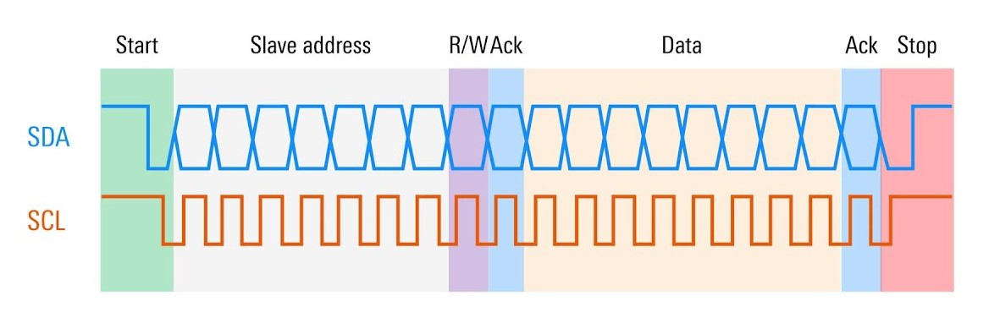
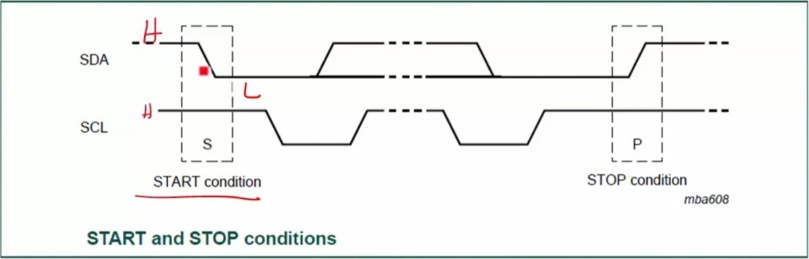

# I2C Communication Protocol


- I2C stands for Inter-Integrated Circuit.  
- It is a **bus interface** connection protocol incorporated into devices for serial communication.

## Working of I2C Communication Protocol
- It uses only 2 bi-directional open-drain lines for data communication called SDA and SCL. Both these lines are pulled high.

    ```
    - Serial Data (SDA) : Transfer of data takes place through this pin.
    - Serial Clock (SCL) : It carries the clock signal.
    ```
- I2C operates in 2 modes:  
        - Master mode  
        - Slave mode  
Each data bit transferred on SDA line is synchronized by a high to the low pulse of each clock on the SCL line.

## Working of I2C Communication protocol


- The data line can not change when the clock line is high.   
- It can change only when the clock line is low. 
- The 2 lines are open drain, hence a pull-up resistor is required so that the lines are high - since the devices on the I2C bus are active low. 
- The data is transmitted in the form of packets which comprises 9 bits. 

### The sequence of these bits are -
1. Start Condition: (1 bit) --- Slave Address: 8 bit
3. Acknowledge: 1 bit

## Steps of I2C Data Transmission?

### Frame Format



1. **Start Condition**: The master device sends a start condition by pulling the SDA line low while the SCL line is high. This signals that a transmission is about to begin.  

2. **Addressing the Slave**: The master sends the 7-bit address of the slave device it wants to communicate with, followed by a read/write bit. The read/write bit indicates whether it wants to read from or write to the slave.  
3. **Acknowledge Bit (ACK)**: The addressed slave device responds by pulling the SDA line low during the next clock pulse (SCL). This confirms that the slave is ready to communicate.
4. **Data Transmission**: The master or slave (depending on the read/write operation) sends data in 8-bit chunks. After each byte, an ACK is sent to confirm that the data has been received successfully.
5. **Stop Condition**: When the transmission is complete, the master sends a stop condition by releasing the SDA line to high while the SCL line is high. This signals that the communication session has ended.  

---

> ### FAQ: What is Start and Stop Conditions ?



**START and STOP can be generated by keeping the SCL line high and changing the level of SDA.**
- To generate START condition the SDA is changed from high to low while keeping the SCL high. 
- To generate STOP condition SDA goes from low to high while keeping the SCL high.
start and stop condition
Start and Stop Condition  

> ### FAQ: What is Repeated Start Condition?
Between each start and stop condition pair, the bus is considered as busy and no master can take control of the bus. If the master tries to initiate a new transfer and does not want to release the bus before starting the new transfer, it issues a new START condition. It is called a REPEATED START condition.

---


**Read/Write Bit**
A high Read/Write bit indicates that the master is sending the data to the slave, whereas a low Read/Write bit indicates that the master is receiving data from the slave. 

**ACK/NACK Bit**
After every data frame, follows an ACK/NACK bit. If the data frame is received successfully then ACK bit is sent to the sender by the receiver.  

**Addressing**
The address frame is the first frame after the start bit. The address of the slave with which the master wants to communicate is sent by the master to every slave connected with it. The slave then compares its own address with this address and sends ACK.

**I2C Packet Format**
In the I2C communication protocol, the data is transmitted in the form of packets. These packets are 9 bits long, out of which the first 8 bits are put in SDA line and the 9th bit is reserved for ACK/NACK i.e. Acknowledge or Not Acknowledge by the receiver. 

**START condition plus address packet plus one more data packet plus STOP condition collectively form a complete Data transfer.**

